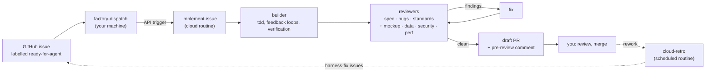

# Agent factory

An agent factory made of Claude Code routines and prompts: GitHub issue in, reviewed PR out.



Three plugins, one marketplace:

| Plugin | What it gives you |
|---|---|
| `factory` | The cloud routines, the seven branch reviewers, the dispatch and stats scripts, `push-pr`. |
| `engineering` | Interactive skills for the same loop at your desk: `architect`, `catch-up`, `review-changes`, `take-over-pr`. |
| `explain` | Explanation formats: SVG diagram, interactive step-by-step page, Simplified Technical English. |

`engineering` and `explain` stand alone. `factory` needs the setup below.

## Install

The factory works on a GitHub repo: its routines read and write issues and PRs through `gh`, and its scripts read the `origin` remote. Have the project on GitHub with `origin` set, and `gh`, `jq` and `curl` installed.

### 1. Plugins

```sh
claude plugin marketplace add thibaultadet/agent-factory
claude plugin install factory@thibaultadet
claude plugin install engineering@thibaultadet
claude plugin install explain@thibaultadet
```

The factory calls skills from [`mattpocock/skills`](https://github.com/mattpocock/skills) (`tdd`, `grilling`, `improve-codebase-architecture`, `pr`):

```sh
claude plugin marketplace add mattpocock/skills
claude plugin install mattpocock-skills@mattpocock
```

Skills only, any agent: `npx skills add thibaultadet/agent-factory`.

### 2. Project config

In the project the factory works on:

1. Run `/setup-matt-pocock-skills`. It writes `docs/agents/issue-tracker.md` and `docs/agents/triage-labels.md`, and the labels the factory reads (`ready-for-agent`, `needs-triage`).
2. Create the labels the factory adds:
   ```sh
   gh label create quick --description "Small fix sent straight to an agent, no triage"
   gh label create PRD --description "Parent issue the factory never builds itself"
   gh label create retro --description "Harness fix proposed by cloud-retro"
   ```
3. Write `docs/agents/factory.md`, at least its § Feedback loops. Start from [`docs/examples/factory.md`](docs/examples/factory.md): keep its headings, the factory finds each section by name. See [Per-project config](#per-project-config).
4. Optional: one `docs/agents/checklists/<reviewer>.md` per reviewer that needs your project's facts, e.g. [`security`](docs/examples/checklists/security.md), [`mockup`](docs/examples/checklists/mockup.md).
5. Commit and push: the cloud routine reads the project from GitHub.

### 3. Cloud routines

On [claude.ai/code](https://claude.ai/code), create a cloud environment for the repo. Its setup script installs the plugins, plus whatever your feedback loops need (language runtimes, a browser for the verification skill):

```sh
claude plugin marketplace add mattpocock/skills && claude plugin install mattpocock-skills@mattpocock
claude plugin marketplace add thibaultadet/agent-factory && for plugin in factory engineering explain; do claude plugin install "$plugin@thibaultadet"; done
```

Then create one routine per entry, on that environment:

| Routine | Trigger | Prompt |
|---|---|---|
| implement-issue | API | ``Run the `factory:implement-issue` skill.`` |
| improve-codebase | schedule (e.g. weekly) | ``Run the `factory:improve-codebase` skill.`` |
| cloud-retro | schedule (Wed, Fri) | ``Run the `factory:cloud-retro` skill.`` |

### 4. Dispatch

The implement-issue routine's page on the web UI shows its API trigger URL and token. Copy both into the project's `.claude/factory.env`, and add that path to `.gitignore`:

```sh
FACTORY_ROUTINE_URL=https://…
FACTORY_ROUTINE_TOKEN=…
```

Then, in a Claude Code session in the project (the plugin puts `bin/` on Claude's `PATH`, not your shell's):

```sh
! factory-dispatch --dry-run   # which issues would start, and why the others skip; needs no token
! factory-dispatch             # one run per eligible issue
```

An issue is eligible when it is open, labelled `ready-for-agent`, unassigned, not a `PRD`, and its blockers are closed. `--stack` also starts an issue whose only open blocker has an open PR, stacked on that PR.

## Per-project config

Every project file the plugins read. All are optional except § Feedback loops: a missing section skips its step, and the pre-review names it on its *Manual* line.

### `docs/agents/factory.md`

| Section | Read by | Holds |
|---|---|---|
| § Feedback loops | builder, fixers, `improve-codebase`, `cloud-retro`, `take-over-pr` | One row per area: path, lint command, test command. **Required**: without it `implement-issue` stops. |
| § Coding standards | builder, polisher, `standards` reviewer, `improve-codebase`, `push-pr`, `catch-up`, `take-over-pr` | The coding standards doc, and the stack doc it points to per area. |
| § Verification | gate, builder, `mockup` reviewer, pre-review | The verification skill (and its mockup comparison), what counts as a user-visible change, the launch command, the publish-evidence command, the evidence folder. |
| § Reviewer triggers | `implement-issue` | Which diff paths start the conditional reviewers (`mockup`, `data`, `security`, `perf`). `spec`, `bugs`, `standards` always run. |
| § Pre-review › Sensitive deny-list | `pre-review` | Paths that make the verdict 🔴 (auth, migrations, billing, lockfiles…). |
| § Pre-review › Factory paths | `pre-review` | Paths that change the factory itself (agent config, CI, these docs). |

### Other files

| File | Read by | Holds |
|---|---|---|
| `docs/agents/checklists/<reviewer>.md` | that reviewer | The project's facts for its lens: auth and scoping root (`security`), copy language, design system and board sources (`mockup`)… Without one the reviewer runs generic. |
| `docs/agents/triage-labels.md` | `implement-issue` | What the triage labels mean. From `/setup-matt-pocock-skills`. |
| `docs/agents/issue-tracker.md` | `catch-up` | How to read an issue. From `/setup-matt-pocock-skills`. |
| `GLOSSARY.md`, `docs/adr/` | `improve-codebase`, `catch-up` | Domain language and past decisions, when the project has them. |
| `.claude/factory.env` | `factory-dispatch` | `FACTORY_ROUTINE_URL`, `FACTORY_ROUTINE_TOKEN`. Gitignored. |

An issue that changes a screen carries a `## Mockup` section in its body. The contract ships with the plugin: [`reviewers/mockup-section.md`](reviewers/mockup-section.md).

## What's inside

### Factory (`factory`)

Routines, run by a cloud routine whose prompt names them:

- **implement-issue** — gate one issue, then build → polish → review → fix until clean, and open a draft PR with its pre-review.
- **improve-codebase** — pick, design and build the best architecture improvement, unattended.
- **cloud-retro** — turn the maintainer's rework of agent PRs into harness-fix issues.

Reviewers, read-only subagents each covering one lens of a branch, dispatched as `factory:<name>`. Each follows [`reviewers/discipline.md`](reviewers/discipline.md):

- **spec** — every line of the issue: delivered, missing or extra.
- **bugs** — business bugs, crashes, breaking changes, missing tests.
- **standards** — the project's coding standards on the changed modules.
- **mockup** — screenshots against the issue's mockup board, screen copy, design system.
- **data** — migrations, indexes, backfills, deploy-time compatibility.
- **security** — auth, record scoping, per-role permissions.
- **perf** — N+1, query per row, missing indexes, needless re-renders.

Scripts, on Claude's `PATH` while the plugin is enabled (`bin/`):

- **factory-dispatch** — fire one `implement-issue` run per issue an agent can start now (`--dry-run`, `--stack`, `--max=N`).
- **issue-brief** — an issue as an agent may read it: body plus the owner's comments only.
- **factory-stats** — merge rate, rework and findings per reviewer of the agent PRs (`--since=YYYY-MM-DD`).

Skills:

- **pre-review** — verdict, shape and `agent-head` of the pre-review comment an agent posts on its PR.
- **push-pr** — clean the commits, check the pre-review points, push the branch and open (or update) a PR with a body from the `pr` skill.

### Engineering (`engineering`)

- **architect** — from a GitHub issue: implement → review → fix loop, verify, then PR — subagents sized per role (model/effort) to save tokens. Adapted from [Adrien Lupo's `ventilate`](https://github.com/adrienlupo/Claude-code-config/tree/main/skills/ventilate).
- **catch-up** — interactive zone-by-zone walkthrough of an agent-built branch, with attention points.
- **review-changes** — review staged and unstaged changes before committing.
- **take-over-pr** — rebase an agent-opened PR on main, resolve conflicts, quick review.

### Explain (`explain`)

From Taha K's article [Quatre façons d'expliquer un harnais](https://tahak.me/posts/quatre-facons-expliquer-un-harnais/).

- **diagram** — explain a technical subject as a single SVG diagram.
- **sim** — interactive step-by-step HTML page with scenarios.
- **ste** — dense explanation in Simplified Technical English style.

## Credits

- [`mattpocock/skills`](https://github.com/mattpocock/skills): the builder works through `tdd`, `improve-codebase` through `improve-codebase-architecture` and `grilling`, PR bodies through `pr`; the issue labels and `docs/agents/` setup come from `setup-matt-pocock-skills` and `triage`.
- [`backnotprop/pstack`](https://github.com/backnotprop/pstack): the verification skill § Verification names is the kind `create-verification-skill` builds and `maintain-verification-skill` keeps current.
- [Adrien Lupo](https://github.com/adrienlupo/Claude-code-config) for `architect`, [Taha K](https://tahak.me/posts/quatre-facons-expliquer-un-harnais/) for `explain`.

## License

[MIT](LICENSE)
